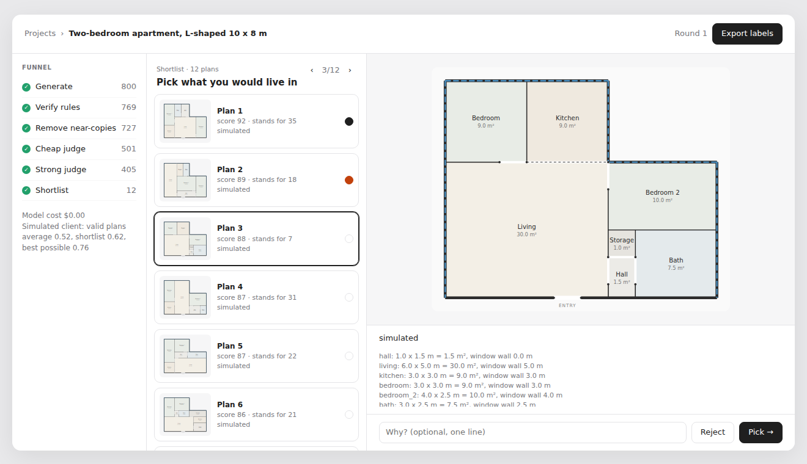

# floorgen

Floor plans from just the outer walls: generate thousands, throw away the bad ones with the cheapest tests first, and show a person twelve.

This is a Python implementation of the method in [Generate, Filter, Judge, Select](https://floorplan.moldandyeast.com/#paper) ([source](https://github.com/moldandyeast/floorplan/tree/floorplan-github-deploy)). That demo runs in the browser on one fixed 9 × 6 m rectangle. This one takes any rectilinear shell (from an outline, or from scanned wall segments) and runs as a batch job, so it can use TypeSafe's Jev, which does not accept browser calls.



## The funnel

| Stage | What | Cost |
| --- | --- | --- |
| 1 Generate | CP-SAT (OR-tools) solves for room rectangles that tile the shell exactly | ~0.15 s per plan per core |
| 2 Verify | Re-checks every rule from the output geometry, independently of the solver | free |
| 3 Dedupe | Drops near-copies (plans that differ in < 6% of cells); keeps the copy with the best target score | free |
| 4 Cheap judge | Jev (or a simulated judge) drops plans with a clear reason to discard | ~$0.00005 per plan |
| 5 Strong judge | Claude Sonnet 5.5 reads the drawing and the measured facts and scores a 5-point rubric | ~$0.005–0.01 per plan per pass (estimate) |
| 6 Select | Greedy quality + coverage selection, plus 2 wildcards | free |
| You | Pick or reject on the review page, with a one-line reason | your time |

Your picks feed back in two ways: as text the judges read in the next round, and as the elite the generator's knobs move toward (cross-entropy step, KL leash, 15% exploration from the prior).

### Why CP-SAT and not wave function collapse

WFC only enforces rules between neighbouring cells. Floor plans fail on rules that span the whole plan: the rooms must tile the shell, every room must be reachable, the front door must open into a hall or living room, and bedrooms need a window. CP-SAT enforces all of them, so every generated plan is valid by construction:

- **Exact tiling.** No-overlap 2D with the shell's notches as fixed blocks, and room areas that sum to the floor area.
- **Connectivity and door rules.** Every room gets a parent it may be entered from (per the brief), shares at least a door's width of wall with it, and sits deeper in a tree rooted at the entry room.
- **Daylight.** Rooms that need it touch a window wall for at least `window_min`.
- **Variety.** This comes from random area targets and random preferred positions in the objective, not from randomness in the search. A deterministic time budget keeps the same (theta, seed) giving the same plan on any machine.

Stage 2 still re-checks every rule. The solver model is code too, and an encoding bug should fail loudly here, not reach the judges.

## Quickstart

```sh
pip install -e '.[llm,dev]'
pytest

# offline: simulated judges, no keys, no cost
floorgen run briefs/one_bed_9x6.json -n 2000 --out runs/one-bed
open runs/one-bed/round-01/review.html        # pick / reject, then "Export labels"
floorgen ingest briefs/one_bed_9x6.json ~/Downloads/labels.json --out runs/one-bed
floorgen run briefs/one_bed_9x6.json -n 2000 --out runs/one-bed   # round 2 learns from you

# live judges
export TYPESAFE_API_KEY=... ANTHROPIC_API_KEY=...
floorgen run briefs/one_bed_9x6.json --cheap jev --strong claude-sonnet-5-5:3 --out runs/live
floorgen calibrate runs/live/round-01 ~/Downloads/labels.json   # does the judge agree with you?

# scanned walls: find gaps and overshoots, with the candidate fixes
floorgen walls briefs/scan_with_issues.json
```

`claude-sonnet-5-5:3` means three judging passes per plan, averaged. Claude calls opt into server-side refusal fallbacks (`fallbacks: "default"`).

## A brief

`briefs/*.json` holds the paper's three layers:

- **Rules:** `rooms` (minimum width and area, `daylight`, `optional`, `count`), `doors` (which rooms each room may be entered from), `entry_rooms`, `door_width`, `window_min`, `max_aspect`.
- **Targets:** `targets`, smooth gates on measured features combined as a geometric mean (`u0`). Used to choose which copy of a near-duplicate to keep.
- **Taste:** `taste`, free text that only the model judges read.

The shell is either `outline` (polygon vertices in metres) or `walls` (segments). Both take an `entry` span and `window_sides`.

## What a simulated run shows

These are 1,500 plans on the 9 × 6 m brief with simulated judges (cheap r = 0.4, strong r = 0.7). The hidden client's true quality averages:

| | true quality |
| --- | --- |
| all valid plans | 0.57 |
| top 12 by strong-judge score | 0.70 |
| diversified shortlist (what you see) | 0.63 |
| best 12 that existed | 0.83 |

Two things to take from this before spending money on live judges:

1. **40% of generated plans were near-copies.** The generator repeats itself, so "20,000 plans" is far fewer distinct ideas. Widen the knobs before raising `-n`.
2. **The diversity term costs quality.** The varied shortlist gives up 0.07 against the pure top 12. `psi` and `wildcards` in `select.py` set that trade. Whether variety is worth it is for your own labels to show, not this simulation.

The simulated client only tests the plumbing. It says nothing about whether Claude agrees with *you*. Run `calibrate` on at least 30 labels before trusting any ranking.

## Known limits

- Rooms are rectangles: no L-shaped rooms. The shell can be any rectilinear shape.
- Only the exterior walls are fixed. Interior load-bearing walls, columns and plumbing stacks are not yet constraints.
- The Jev request shape is copied from the reference demo. It has not been tested against TypeSafe's docs or a live key.
- The Claude judge has been checked for request shape only, not run live in this repo.
- Not built yet: pairwise Bradley–Terry ranking, a held-out labelled set, stratified threshold calibration for `tau`.

## Roadmap

**Phase 2: furniture.** Fit furniture per room as a second CP-SAT model: wall-anchored items, door-swing and walkway clearances, a bed with access on both sides. It does two jobs:

- a hard check ("a double bed fits") that removes plans whose rooms meet the minimums but cannot be furnished;
- a richer drawing for the judges and the 3D walkthrough.

**Phase 3:** export the chosen plans to the 3D walkthrough.

## Layout

```
floorgen/
  shell.py     shell grid, exterior edges, notches
  walls.py     scanned walls: gap / overshoot / off-grid detection and fixes
  brief.py     the brief (rules, targets, taste)
  generate.py  stage 1, CP-SAT
  checks.py    stage 2, independent verification with margins
  features.py  stage 3, features, dedupe archive, target score u0
  judges.py    stages 4-5, Jev, Claude, simulated
  select.py    stage 6, greedy F(S) + wildcards
  learn.py     cross-entropy sampler update with KL leash
  pipeline.py  one round end to end; ingest
  review.py    the review page
  render.py    SVG / PNG
```
